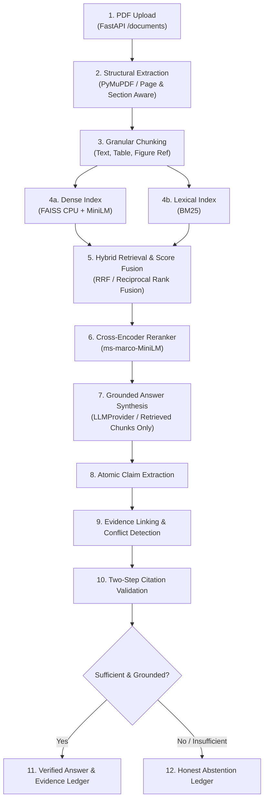
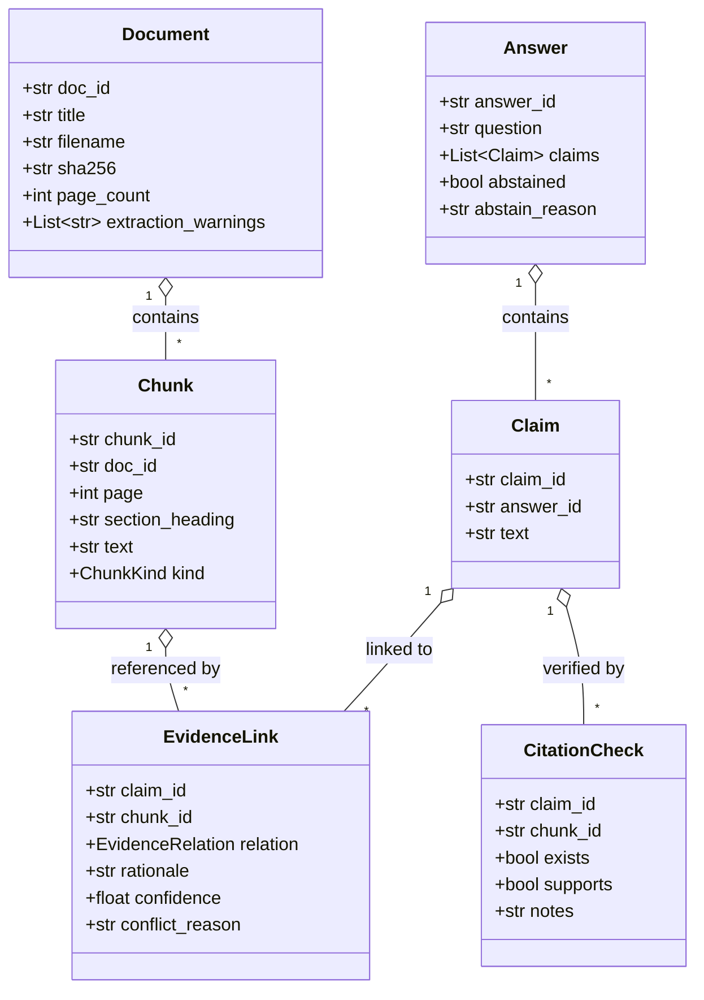
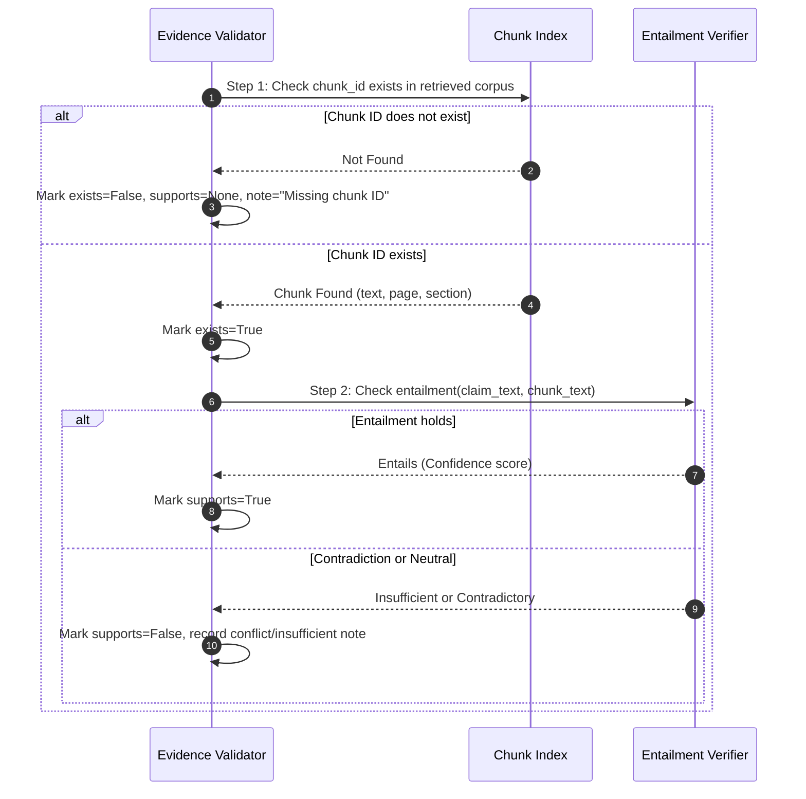

# PaperTrail AI — System Architecture 📑🏛️

## 1. Executive Summary

PaperTrail AI is an evidence-first multi-paper research synthesis engine. Unlike generic "chat with PDFs" tools that summarize ungrounded text and suffer from hallucinations, PaperTrail AI produces a verifiable **claim-to-evidence ledger** across academic literature.

Every sentence generated by the system is decomposed into atomic claims, linked directly to granular chunk IDs in source documents, validated through a two-step citation check, and annotated with causal reasons if apparent conflicts arise between papers.

---

## 2. End-to-End Processing Pipeline

The pipeline follows a strict unidirectional processing topology:

### Detailed Pipeline Stages

1. **Upload (`POST /documents`)**:
   - Ingests uploaded PDF documents, computes cryptographic SHA-256 hashes for provenance, and validates file headers.
2. **Page & Section Aware Extraction (PyMuPDF)**:
   - Preserves 1-indexed page boundaries.
   - Parses document hierarchy (headers, subheaders, body text, tables).
   - **Zero Silent Drops**: Any extraction difficulty (empty page, rasterized scan, unrenderable font) generates an explicit entry in `Document.extraction_warnings`.
3. **Chunking**:
   - Groups structural blocks into logical segments with bounded token lengths.
   - Tags each chunk with `kind`: `text`, `table`, or `figure_ref`.
   - Attaches active `section_heading` to every chunk for context preservation.
4. **Hybrid Retrieval**:
   - **Dense Index**: FAISS CPU with sentence-transformers (`all-MiniLM-L6-v2`) for semantic similarity.
   - **Lexical Index**: `rank-bm25` for exact symbol, equation, author, and technical term matching.
5. **Score Fusion**:
   - Blends sparse and dense scores via Reciprocal Rank Fusion (RRF) to eliminate scale mismatches.
6. **Cross-Encoder Reranker**:
   - Re-scores top-k candidates using a cross-encoder (`cross-encoder/ms-marco-MiniLM-L-6-v2`) to capture deep query-chunk interactions.
7. **Grounded Answer Synthesis**:
   - The LLM receives **only** the top reranked chunks in its system prompt with strict instructions not to rely on parametric memory.
   - LLM integration is completely abstract (`LLMProvider` interface in `backend/app/llm/`), dynamically calling Gemini.
8. **Atomic Claim Extraction**:
   - Breaks down the generated synthesis into granular, independently verifiable statements (one assertion per claim).
9. **Evidence Linking & Apparent Conflict Resolution**:
   - Compares claims against retrieved chunks and assigns relations:
     - `supports`
     - `weakens`
     - `contradicts`
     - `contextualizes`
     - `insufficient`
   - **Rule of Apparent Conflict**: When two sources disagree, the engine **never** asserts an unqualified contradiction. It isolates and records the causal differential factor in `conflict_reason` (e.g., differing evaluation benchmarks, tokenizer variations, or hardware environments).
10. **Two-Step Citation Validation**:
    - **Step 1 (Existence)**: Validates that the chunk ID exists in the corpus and retrieved set.
    - **Step 2 (Support)**: Evaluates semantic entailment between the chunk text and the claim.
11. **Answer or Honest Abstention**:
    - If retrieved evidence is missing or contradictory without clear resolution, the system abstains honestly with an explicit `abstain_reason`.

---

## 3. Data Contracts & Schema Hierarchy

---

## 4. Two-Step Citation Validation Protocol

---

## 5. Evaluation Protocol

Evaluations are recorded in `eval/runs/` with strict provenance tracking:
- **Retrieval Quality**: Recall@k, Precision@k, MRR, nDCG broken down by question type (`factual`, `comparative`, `apparent_conflict`, `unanswerable`, `methodological`).
- **Grounding Fidelity**: Citation precision, citation coverage, claim support rate, unsupported-claim rate.
- **Conflict Handling**: Precision, recall, and false-conflict rate on opposing claims.
- **Abstention Accuracy**: Rate of correct abstentions on unanswerable questions.
- **Operational Metrics**: Latency (p50/p95), tokens consumed, and error rates.
