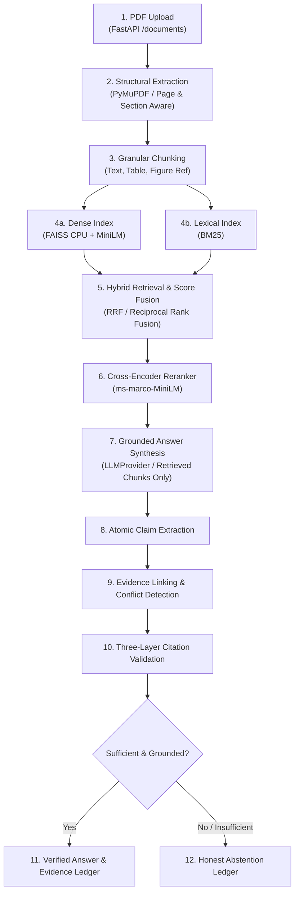
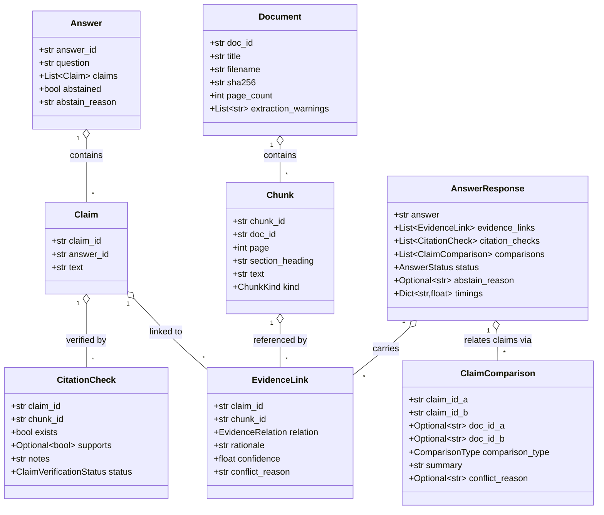
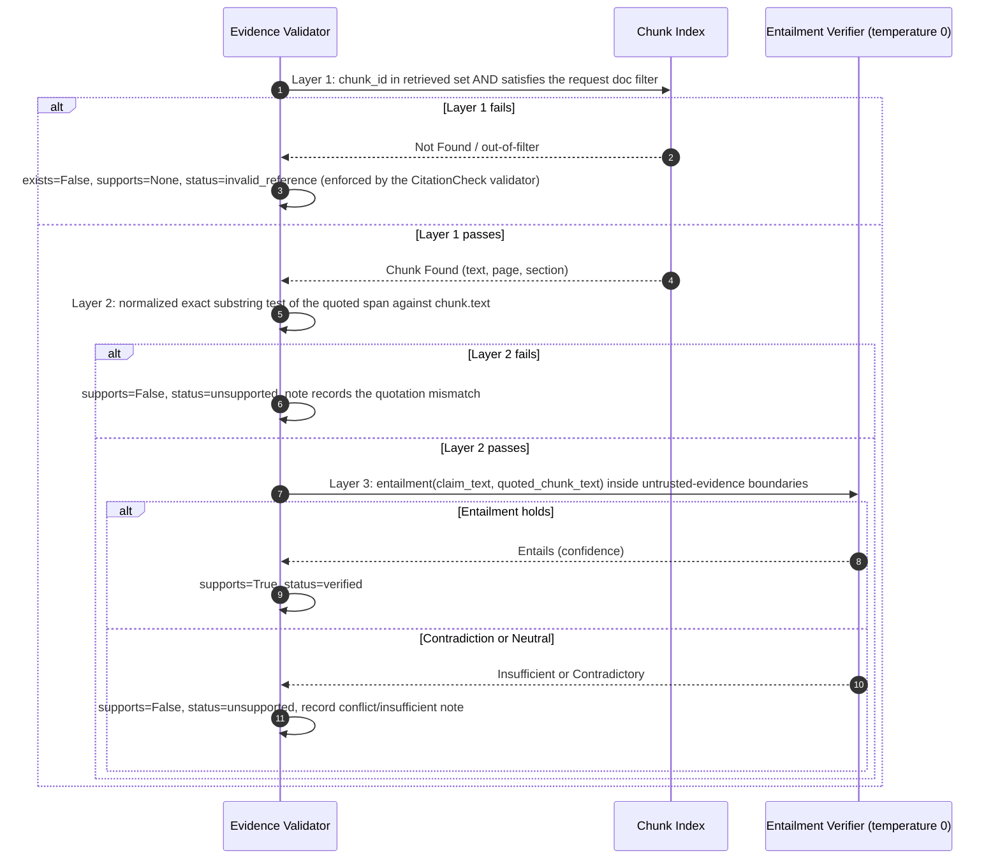

# PaperTrail AI — System Architecture 📑🏛️

## 1. Executive Summary

PaperTrail AI is an evidence-first multi-paper research synthesis engine. Unlike generic "chat with PDFs" tools that summarize ungrounded text and suffer from hallucinations, PaperTrail AI produces a verifiable **claim-to-evidence ledger** across academic literature.

Every sentence generated by the system is decomposed into atomic claims, linked directly to granular chunk IDs in source documents, validated through a three-layer citation check (existence, verbatim quotation, entailment), and annotated with causal reasons if apparent conflicts arise between papers.

---

## 2. End-to-End Processing Pipeline

The pipeline follows a strict unidirectional processing topology:

### Detailed Pipeline Stages

1. **Upload (`POST /documents`)**:
   - Ingests uploaded PDF documents, computes cryptographic SHA-256 hashes for provenance, and validates file headers.
2. **Page & Section Aware Extraction (PyMuPDF)**:
   - Preserves 1-indexed page boundaries.
   - Parses document hierarchy (headers, subheaders, body text, tables).
   - **Zero Silent Drops**: Any extraction difficulty (empty page, rasterized scan, unrenderable font) generates an explicit entry in `Document.extraction_warnings`.
3. **Chunking**:
   - Groups structural blocks into logical segments with bounded token lengths.
   - Tags each chunk with `kind`: `text`, `table`, or `figure_ref`.
   - Attaches active `section_heading` to every chunk for context preservation.
4. **Hybrid Retrieval**:
   - **Dense Index**: FAISS CPU with sentence-transformers (`all-MiniLM-L6-v2`) for semantic similarity.
   - **Lexical Index**: `rank-bm25` for exact symbol, equation, author, and technical term matching.
5. **Score Fusion**:
   - Blends sparse and dense scores via Reciprocal Rank Fusion (RRF) to eliminate scale mismatches.
6. **Cross-Encoder Reranker**:
   - Re-scores top-k candidates using a cross-encoder (`cross-encoder/ms-marco-MiniLM-L-6-v2`) to capture deep query-chunk interactions.
7. **Grounded Answer Synthesis**:
   - The LLM receives **only** the top reranked chunks in its system prompt with strict instructions not to rely on parametric memory.
   - LLM integration is completely abstract (`LLMProvider` interface in `backend/app/llm/`), dynamically calling Gemini.
8. **Atomic Claim Extraction**:
   - Breaks down the generated synthesis into granular, independently verifiable statements (one assertion per claim).
9. **Evidence Linking & Apparent Conflict Resolution**:
   - Each claim-to-chunk link carries one `EvidenceRelation` value:
     - `supports`
     - `weakens`
     - `contradicts`
     - `contextualizes`
     - `insufficient`
   - Each structured cross-paper comparison carries one `ComparisonType` value — a **separate enum**:
     `supports`, `contradicts`, `apparent_conflict`, `unresolved`.
   - **Rule of Apparent Conflict**: When two sources disagree, the engine **never** asserts an unqualified contradiction. It isolates and records the causal differential factor in `conflict_reason` (e.g., differing evaluation benchmarks, tokenizer variations, or hardware environments).
   - Note the asymmetry, because it bites anyone reading the benchmark: `EvidenceRelation` has **no** `apparent_conflict` member. An apparent conflict is therefore recorded at evidence level as `contradicts` (or `weakens`) plus a `conflict_reason`, and only the comparison enum can spell the category out directly. `expected_relation` in `eval/gold_evidence.jsonl` uses `EvidenceRelation`, so a gold item labelled `contradicts` whose reason names a condition difference is a label/reason disagreement for the reviewer to settle, not a third enum value.
10. **Three-Layer Citation Validation**:
    - **Layer 1 (Existence)**: the chunk must exist in the retrieved evidence set and satisfy the request's document filter. Failure forces `supports = None` and status `invalid_reference` — a validator-enforced invariant, not a convention.
    - **Layer 2 (Verbatim)**: the quoted span must be a normalized exact substring of that chunk's stored text.
    - **Layer 3 (Entailment)**: a separate temperature-0 LLM call decides whether the passage actually supports the claim.
11. **Answer or Honest Abstention**:
    - If retrieved evidence is missing or contradictory without clear resolution, the system abstains honestly with an explicit `abstain_reason`.

---

## 3. Data Contracts & Schema Hierarchy

`Answer` is the internal synthesis contract; `AnswerResponse` is what `POST /answer` returns and is
the only place `comparisons` and `citation_checks` are carried to the client.

Two enums carry the relation vocabulary and they are **not interchangeable**, which is the single most
common source of confusion when reading the ledger:

| Enum | Where it appears | Members |
| --- | --- | --- |
| `EvidenceRelation` | `EvidenceLink.relation`, `GoldEvidence.expected_relation` | `supports`, `weakens`, `contradicts`, `contextualizes`, `insufficient` |
| `ComparisonType` | `ClaimComparison.comparison_type`, the Cross-Paper view | `supports`, `contradicts`, `apparent_conflict`, `unresolved` |

`ClaimVerificationStatus` (`verified`, `unsupported`, `invalid_reference`, `unverified`) describes the
outcome of the three-layer check on a single citation, not the relation between two claims. The frontend
mirrors all three types one-for-one in `frontend/src/lib/types.ts:79-96`, and
`frontend/src/lib/comparison-meta.tsx` is the only place the four comparison labels are worded for display.

---

## 4. Three-Layer Citation Validation Protocol

Layers 1 and 2 are deterministic and run first (`CitationVerifier.check_deterministic`); layer 3 is
a separate model call and only runs if both deterministic layers pass
(`backend/app/citations/verifier.py:299-305, 520-545`).

A claim is promoted to `verified` only when all three layers pass. Anything that clears layers 1–2
but fails entailment, or whose quotation is not verbatim, is displayed as unverified and never
silently upgraded. A fourth status, `unverified`, is reserved for the case where entailment could not
be evaluated at all — provider failure, timeout, or an unparseable verdict — so "the model did not
answer" is never rendered as either "verified" or "contradicted".

---

## 5. Evaluation Protocol

Evaluations are recorded in `eval/runs/` with provenance (`run_id`, `timestamp`, `git_commit`,
`candidate_pool_size`, model names, chunker settings, `total_corpus_chunks`, per-subset `n`).

**Computed today** (`backend/app/eval/metrics.py` + `run_retrieval.py`, against the stored corpus,
fully offline):

- **Retrieval quality**: `recall@{1,3,5,10}`, `precision@{1,3,5,10}`, `mrr`, `ndcg@{1,3,5,10}` for four
  configurations (BM25 only, dense only, hybrid + RRF, hybrid + cross-encoder rerank), with 95%
  bootstrap confidence intervals, split by the answerable question types present in the set
  (`factual`, `comparative`, `methodological`, `apparent_conflict`) and by label provenance
  (researcher-drafted versus assistant-drafted).
- **Grounding fidelity** (`run_conflicts.py`, scripted provider): per-question rates for retrieval of
  the gold spans, three-layer citation verification, and conflict surfacing; `overall_grounded_success_rate`;
  `relation_label_checked_count` / `relation_label_match_count` reported **separately** rather than folded
  into the pass rates; and `contradicts_labels_emitted`, which exists to catch an unearned contradiction
  label and is currently always empty.
- **Gold integrity**: `verify_gold` resolves every gold span against the stored chunks;
  `review_worksheet --check` audits label integrity and human-verification counts.

**Designed, not implemented — do not quote these as results:**

- Conflict *precision, recall and false-conflict rate*. The conflict runner answers through scripted
  `MockLLMProvider` responses, so it measures whether the pipeline honours a conflict handed to it, not
  whether it finds one. No genuine cross-paper contradiction has been located in this corpus
  (302 opposition-bearing sentences, 30 cross-document candidates, 0 survivors — [benchmark-contradictions.md](benchmark-contradictions.md)).
- Abstention accuracy as a scored rate. The five unanswerable questions are **reserved** — excluded from
  every denominator — and abstention behaviour is evidenced by tests and controlled live checks, not by a
  published accuracy number.
- Operational metrics: `POST /answer` does return per-stage wall-clock latencies in
  `AnswerResponse.timings`, but nothing aggregates them — there are no latency percentiles, no token
  consumption accounting, and no error-rate series in any runner or artifact in this repository.
